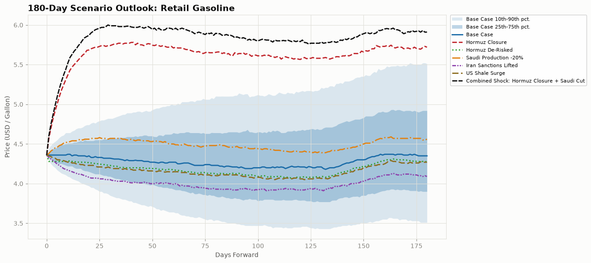
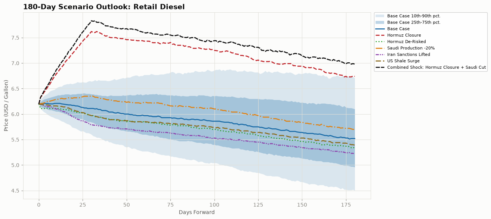
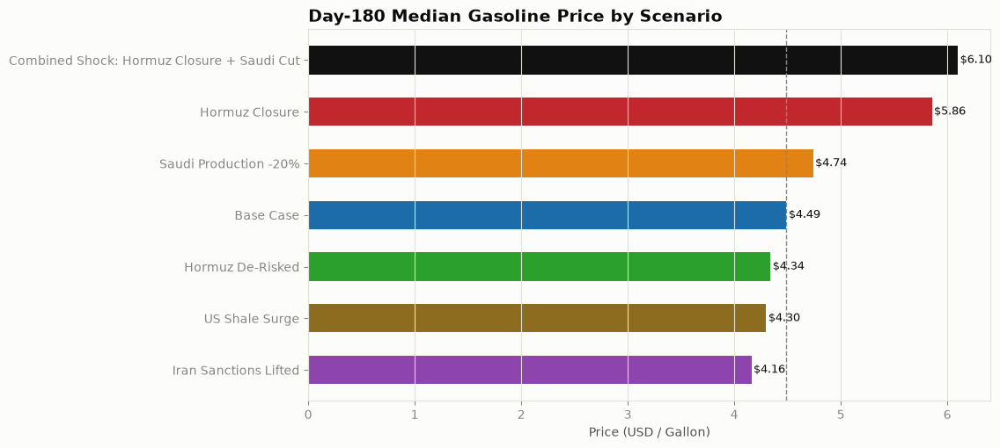

# Oil & Fuels Market Outlook - Scenario Analysis
*As of 2026-10-21 | 2,000-path Monte Carlo, 180-day horizon*

**AAA national average retail prices (2026-10-21):** Regular **$4.264/gal**, diesel **$6.317/gal** ([AAA Gas Prices](https://gasprices.aaa.com/)). These are a snapshot from the last report run, not live prices. This model projects a *medium-term path* for the crude-to-pump price chain, not today's station price, so some gap is expected — but if the gap looks large, check the "Calibration inputs" line under Methodology first: the model is only as current as the last `calibrate.py` run.

## Executive Summary

Under current calibrated conditions, the model's base-case median retail gasoline price reaches **$4.40/gal** 180 days out (10th-90th percentile range $3.52-$5.48). Across the six stress scenarios modeled below, the most bullish case is **Combined Shock: Hormuz Closure + Saudi Cut**, which pushes the day-180 median to $5.88/gal (+33.6% vs. base), while **Iran Sanctions Lifted** offers the most relief, at $4.13/gal (-6.1% vs. base).

## Scenario Summary Table (Gasoline)

| Scenario | Day 30 | Day 90 | Day 180 | Day 180 10th-90th pct. | vs. Base |
|---|---|---|---|---|---|
| Base Case | $4.34 | $4.25 | $4.40 | $3.52-$5.48 | - |
| Hormuz Closure | $5.84 | $5.61 | $5.64 | $4.24-$7.74 | +28.3% |
| Hormuz De-Risked | $4.22 | $4.09 | $4.19 | $3.44-$5.21 | -4.8% |
| Saudi Production -20% | $4.57 | $4.44 | $4.57 | $3.68-$5.86 | +3.9% |
| Iran Sanctions Lifted | $4.04 | $3.95 | $4.13 | $3.35-$5.17 | -6.1% |
| US Shale Surge | $4.21 | $4.12 | $4.26 | $3.50-$5.37 | -3.2% |
| Combined Shock: Hormuz Closure + Saudi Cut | $6.09 | $5.83 | $5.88 | $4.36-$8.28 | +33.6% |

## Scenario Summary Table (Diesel)

| Scenario | Day 30 | Day 60 | Day 90 | Day 180 |
|---|---|---|---|---|
| Base Case | $6.11 | $5.97 | $5.89 | $5.52 |
| Hormuz Closure | $7.62 | $7.43 | $7.29 | $6.74 |
| Hormuz De-Risked | $5.97 | $5.85 | $5.73 | $5.33 |
| Saudi Production -20% | $6.36 | $6.23 | $6.12 | $5.70 |
| Iran Sanctions Lifted | $5.79 | $5.67 | $5.57 | $5.22 |
| US Shale Surge | $5.97 | $5.85 | $5.76 | $5.39 |
| Combined Shock: Hormuz Closure + Saudi Cut | $7.83 | $7.60 | $7.48 | $6.98 |

## Scenario Detail

### Base Case

Current calibrated market conditions, including the manually-reviewed disruption_severity.json blend toward current chokepoint/freight conditions (see Methodology); no additional policy or geopolitical shock applied on top.

Day-180 median: **$4.40/gal** gasoline (base case), $5.52/gal diesel.

### Hormuz Closure

Strait of Hormuz effectively shut: roughly 55% of its normal throughput is assumed offline, chokepoint disruption frequency quadruples, and the war-risk shipping premium triples.

Day-180 median: **$5.64/gal** gasoline (+28.3% vs. base), $6.74/gal diesel.

### Hormuz De-Risked

Geopolitical tension around the strait fully unwinds: disruption frequency falls to a fifth of baseline and the war-risk premium halves, with no direct change to physical supply.

Day-180 median: **$4.19/gal** gasoline (-4.8% vs. base), $5.33/gal diesel.

### Saudi Production -20%

Saudi Arabia cuts output and spare capacity by 20%, e.g. an OPEC+ supply-discipline shock.

Day-180 median: **$4.57/gal** gasoline (+3.9% vs. base), $5.70/gal diesel.

### Iran Sanctions Lifted

Sanctions are lifted, letting Iranian output ramp toward a materially higher production ceiling.

Day-180 median: **$4.13/gal** gasoline (-6.1% vs. base), $5.22/gal diesel.

### US Shale Surge

US shale operators ramp drilling activity, lifting both current output and spare capacity.

Day-180 median: **$4.26/gal** gasoline (-3.2% vs. base), $5.39/gal diesel.

### Combined Shock: Hormuz Closure + Saudi Cut

A simultaneous Hormuz closure and 20% Saudi production cut - a tail-risk stack of the two largest supply-side scenarios.

Day-180 median: **$5.88/gal** gasoline (+33.6% vs. base), $6.98/gal diesel.

## Charts

## Methodology

Each scenario re-runs the full 2,000-path stochastic simulation (`simulate.go`) with a modified set of inputs. Chokepoint scenarios (Hormuz closure/de-risking) adjust the model's existing disruption frequency and shipping-risk mechanics directly. Production scenarios additionally apply a first-order crude price shock: each 1% of global supply added or removed is assumed to move crude price 6% in the opposite direction (a simplifying short-run elasticity assumption, not a fitted econometric estimate), phased in linearly over the first 30 days rather than overnight - so every scenario starts at today's observed price and the day-30 figures reflect the full shock - with volatility scaled up in proportion to shock size so tail scenarios carry wider, not just higher or lower, confidence bands. This is a model output for illustrative what-if analysis, not investment advice.

**Drift anchor:** the base case has no independent view on direction. Crude and both crack spreads are anchored to the CL/HO/RB forward curves, so the expected path is the market's own, and the simulation supplies the distribution around it. Scenario shocks shift that whole anchor path rather than replacing it. Futures are a risk-neutral expectation and not a forecast - in backwardation they will tend to read lower than a realized spot path - so treat the level as market-implied rather than predicted. Note also that the **median** sits below the **mean** at longer horizons because crude is lognormal: that gap is a property of the distribution, not a bearish view.

**Calibration inputs:** last calibrated on **2026-10-21** by `calibrate.py` from live NYMEX crude/gasoline/diesel futures (`yfinance`). If that date is stale, or reads "unknown" (no `date_calibrated` field), the base case below reflects old or placeholder inputs rather than today's market — re-run `python calibrate.py` before trusting the baseline.

**Current-conditions input:** the base case blends 40% of the way from calm-floor chokepoint/freight assumptions toward the Hormuz Closure scenario's values, per `disruption_severity.json` (reviewed 2026-09-30: EIA weekly retail diesel $5.97->$6.29->$6.53/gal over 3 weeks; Goldman Sachs/Morgan Stanley notes on distillate tightness, refinery crunch, and rerouted tanker freight amid Hormuz-related disruption). This is a manual, periodically-updated judgment call, not a live feed — re-review it as conditions change.
